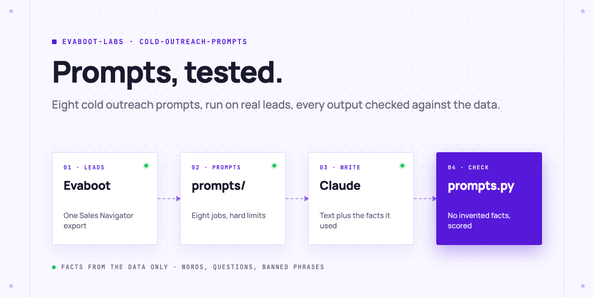
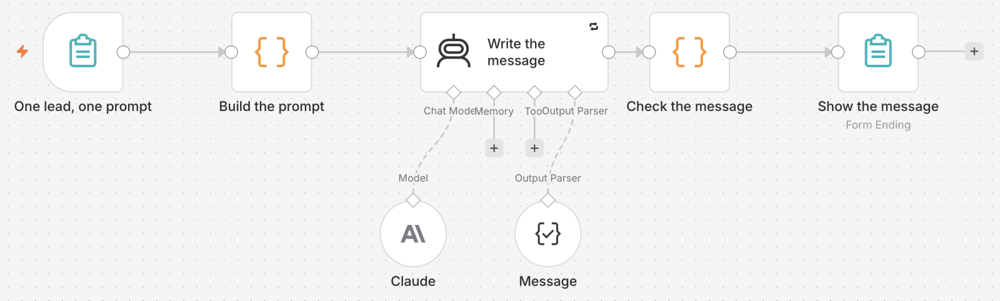

<picture>
  <source media="(prefers-color-scheme: dark)" srcset=".github/assets/banner-dark.png">
  
</picture>

# Cold outreach prompts, tested

Eight prompts for cold outreach (first line, short email, subject lines, follow-up, break-up, LinkedIn note, objection reply, referral ask) that your AI Agent runs on real leads from an Evaboot export. Every output lists the facts it used, and a check rejects anything it cannot find in the lead's data.

[](AGENTS.md)
[](https://evaboot.com/mcp)
[](LICENSE)

## Set it up in one prompt

Paste this into Claude Code, Codex or Cursor:

```text
Clone https://github.com/evaboot-labs/cold-outreach-prompts, read AGENTS.md and follow the skill. Test the cold outreach prompts on my Evaboot export.
```

<details>
<summary>Or install the skill</summary>

Claude Code:

```text
/plugin marketplace add evaboot-labs/cold-outreach-prompts
/plugin install cold-outreach-prompts@evaboot-labs-cold-outreach-prompts
```

Codex, Cursor and other agents:

```bash
npx skills add evaboot-labs/cold-outreach-prompts
```

</details>

## How it works

**1. Real leads.** `prompts.py facts` keeps the people with a safe email from an Evaboot export: name, title, company, size, growth, months in role, headline, company description.

**2. Eight prompts, one job each.** Each file in [`prompts/`](prompts) holds the instruction and its limits: words, characters, questions. The runner adds the limits and the rules to every call.

**3. Claude writes, and says what it used.** Every output comes back with the facts it took from the lead's data.

**4. Every output checked.** `prompts.py check` rejects a fact or a number that is not in the data or your offer, a line over the limit, an extra question, a spam word or a guess at someone's gender. `prompts.py score` gives one line per prompt:

```text
$ python3 prompts.py score
prompt             outputs  passed  words  most common failure
breakup                 10      10     41  -
first-line              10       9     23  words, max 25
follow-up               10      10     51  -
linkedin-note           10      10     40  -
objection-reply         10      10     54  -
referral-ask            10       9     42  questions, max 1
short-email             10      10     70  -
subject-lines           10      10     13  -
```

Our first run of the first-line prompt passed 0 of 10: without the limit in the prompt, every line ran 30 to 37 words. With it, 9 of 10.

**5. Or give your team a form.** The n8n version runs one prompt on one lead and shows the check.



## What you need

- An [Evaboot account](https://dash.evaboot.com/accounts/signup/?last_click_origin=cold-outreach-prompts-repo) for the leads: one export of your Sales Navigator search, 1 credit per lead.
- An Anthropic API key. Our test of 8 prompts on 10 leads made 80 calls.
- An AI Agent: Claude Code, Codex, Cursor, or n8n for the form.
- Python 3.9+, with no packages to install.

## Go further

| Page | For |
|---|---|
| [docs/connect-your-agent.md](docs/connect-your-agent.md) | The key, the export and the setup by hand |
| [docs/n8n.md](docs/n8n.md) | One prompt on one lead, as a form |
| [OFFER.md](OFFER.md) | Your product, problem, proof and call to action |
| [prompts/](prompts) | The eight prompts and their limits |

---

Agents: start at [AGENTS.md](AGENTS.md) · Built by [Evaboot](https://evaboot.com) · More workflows at [github.com/evaboot-labs](https://github.com/evaboot-labs) · [MIT license](LICENSE)
